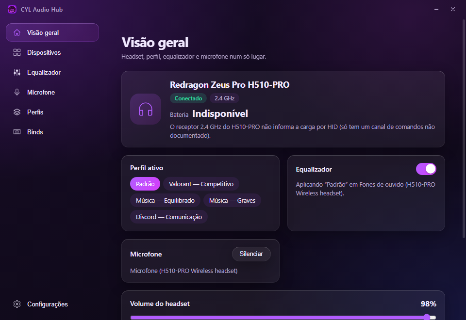
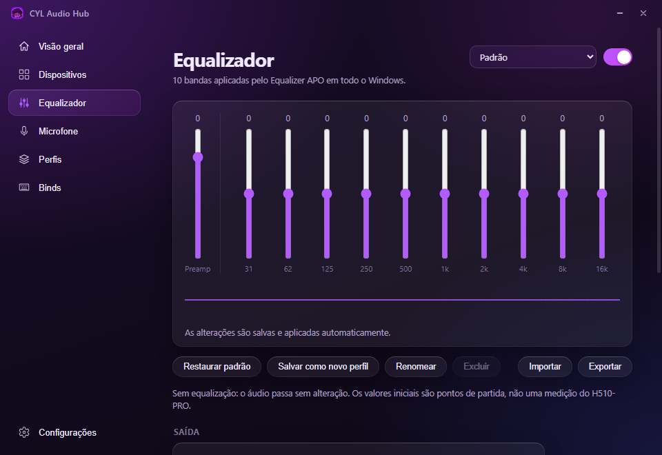
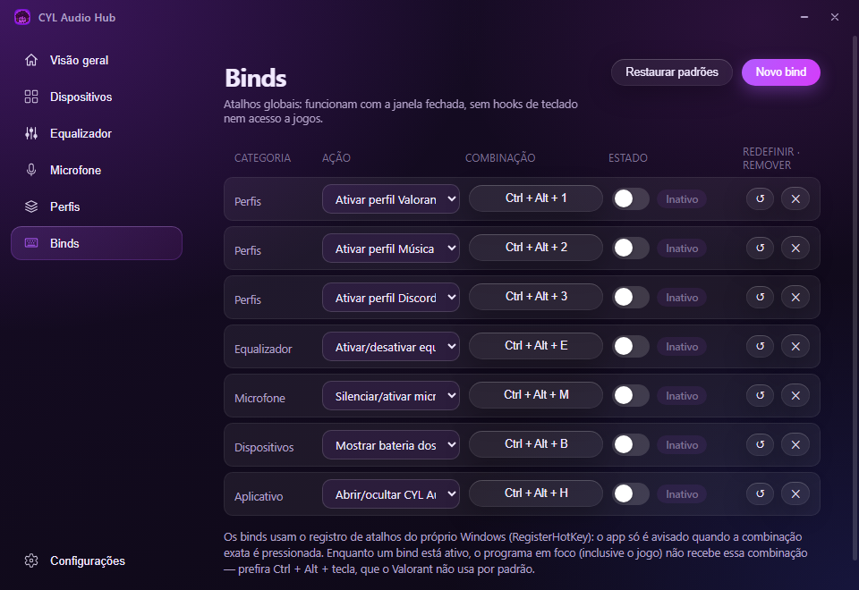
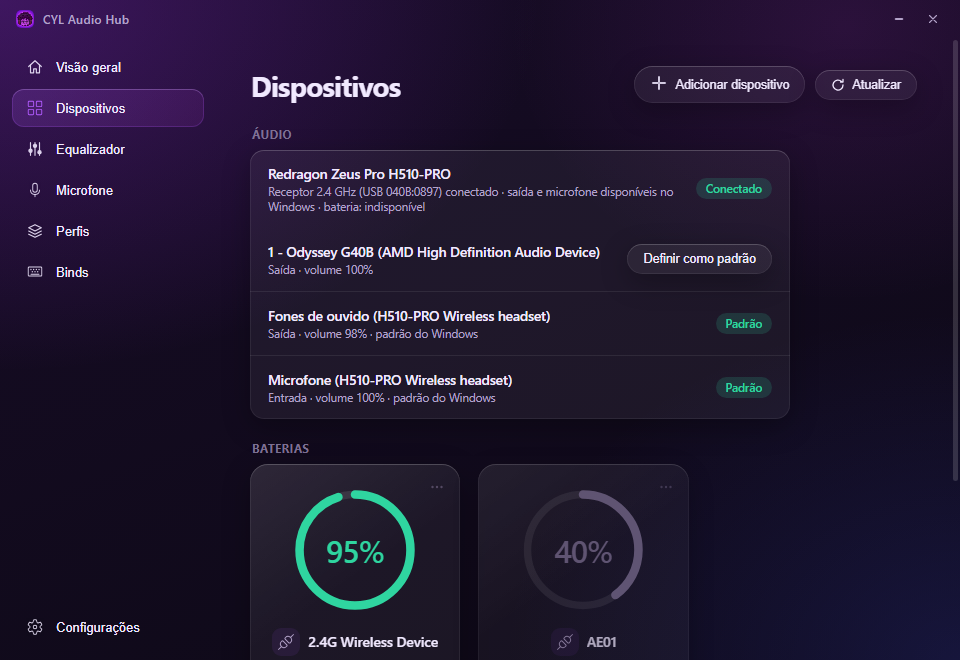
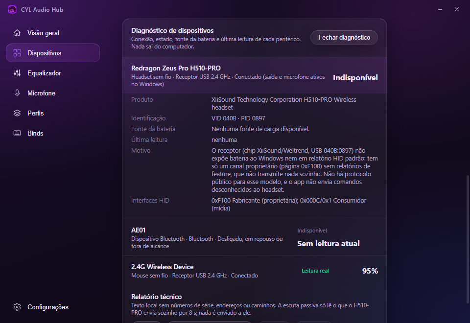
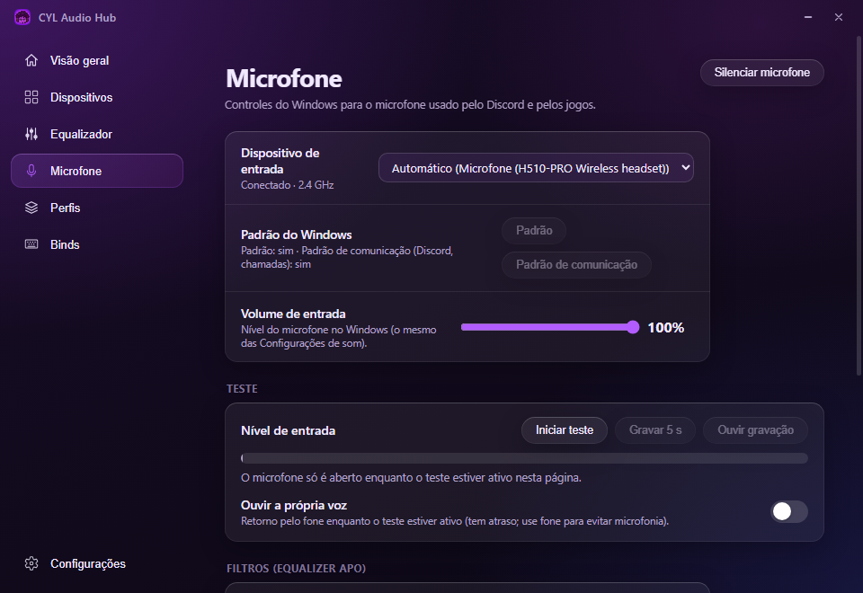
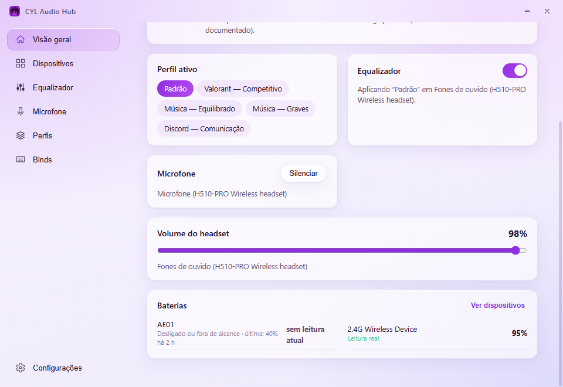

<div align="center">
  
  <h1>CYL Audio Hub</h1>
  <p><strong>Bateria, equalizador, microfone, perfis e atalhos globais num só app de bandeja para Windows.</strong></p>
  <p>Feito para o headset <b>Redragon Zeus Pro H510-PRO Wireless (2.4 GHz)</b> e para os periféricos sem fio do mesmo PC.</p>
  <p><a href="https://github.com/cellixx7/Cyl_Hub">github.com/cellixx7/Cyl_Hub</a></p>
</div>

---

O CYL Audio Hub junta três coisas que antes ficavam espalhadas:

- o monitor de baterias do [Battery Hub](https://github.com/battery-hub/battery-hub);
- o controle de áudio do Zeus Pro Suite (motor WASAPI);
- um equalizador de 10 bandas que processa o áudio de verdade pelo [Equalizer APO](https://sourceforge.net/projects/equalizerapo/).

Ele fica ao lado do relógio, consome pouco e foi pensado para rodar junto com jogos como o Valorant.

<p align="center">
  
</p>

## Identidade visual

A arte do CYL está em [`src/imgs`](src/imgs), que é a fonte de toda a identidade do app:

| Arquivo | Conteúdo | Onde é usado |
|---|---|---|
| `src/imgs/logo_app.png` | Logo completo: o CYL com fone, ícone de bateria e de equalizador | Ícone do app e do instalador (48 a 256 px), notificações, tela Sobre, estado vazio |
| `src/imgs/icon_bandeja.png` | Versão mais simples, sem os ícones | Bandeja do Windows (16/32 px), ícone em 16 a 32 px, marca na barra de título |

O script `npm run brand` (`scripts/build-brand.js`, sem dependências) faz quatro coisas:

- remove o fundo branco das referências com borda suavizada;
- reduz as imagens por média de área;
- gera `assets/icon.ico`, os PNGs da bandeja e os da interface;
- deixa as imagens originais de fora do instalador.

A paleta foi medida nas próprias imagens: roxo `#9a2fe6`, rosa `#d43df9` e azul só em brilhos suaves, sobre fundo escuro. Não há blur nem animação contínua: o efeito de vidro são superfícies translúcidas sobre um gradiente estático.

## Funcionalidades

### Bateria dos periféricos
- **Leitura real, estimativa ou indisponível.** Cada valor diz de onde vem, e uma leitura antiga ou de dispositivo desligado nunca aparece como atual.
- **Fontes de leitura:**
  - drivers HID do Battery Hub (Logitech, Razer, Attack Shark/Xenta, Sinowealth e outros);
  - bateria Bluetooth informada pelo Windows.
- **Recursos herdados do Battery Hub:** histórico de 24 h e 7 dias, detecção de carregamento e alertas de bateria fraca configuráveis.
- **Dispositivos › Diagnóstico**, para cada periférico:
  - tipo, conexão, estado e VID/PID;
  - fonte da bateria e última leitura;
  - motivo da indisponibilidade e interfaces HID.
- **Relatório técnico local** para copiar ou exportar, sem números de série, endereços ou caminhos. Ele tem uma **escuta passiva** opcional que só lê o que o dispositivo transmite sozinho e nunca envia nada a ele.

### Equalizador (Equalizer APO)
- **Ajustes:** 10 bandas (31 Hz a 16 kHz) e preamp, com aviso de risco de clipping e botão de preamp automático.
- **Arquivos do Equalizer APO:** o CYL escreve só o arquivo próprio `cyl-audio-hub.txt` e uma linha `Include:` no `config.txt`. Faz backup antes, grava de forma atômica e o botão **Remover** desfaz tudo.
- **Saída de áudio:** a curva vale só para a saída escolhida (por padrão o H510-PRO), sem mexer nas outras.
- **Sem surround virtual:** é um EQ estéreo, então não duplica o áudio espacial (HRTF) do Valorant.

### Microfone
- Escolha do dispositivo, padrão do Windows (geral e de comunicação), volume de entrada e silenciar.
- Teste com medidor de nível, gravação de 5 s e retorno opcional. O microfone só fica aberto durante o teste.
- Filtros opcionais por perfil (passa-altas e presença) via Equalizer APO, quando o APO estiver ativo no microfone.

### Perfis
- **Perfis iniciais:**
  - Padrão;
  - Valorant — Competitivo;
  - Música — Equilibrado;
  - Música — Graves;
  - Discord — Comunicação.

  Os valores são pontos de partida, não medições do headset.
- **Gerenciamento:** criar, duplicar, renomear, excluir, restaurar, reordenar, importar e exportar (JSON).
- **Troca automática opcional por programa:** por exemplo, `valorant-win64-shipping` ativa o perfil Valorant.

### Binds (atalhos globais)
- Sete atalhos de exemplo (Ctrl+Alt+1/2/3/E/M/B/H), **desligados por padrão**. Todos podem ser alterados, desativados ou removidos, e é possível criar novos.
- **Como são registrados:** pelo registro de atalhos do próprio Windows (`RegisterHotKey`). Não há hook de teclado, keylogger, injeção ou acesso à memória de jogos.
- Funcionam com a janela fechada e voltam sozinhos depois que o PC sai da suspensão.
- **Conflitos:**
  - uma combinação em uso por outro programa é marcada com o motivo, sem afetar as demais;
  - o app avisa sobre Ctrl+Alt (AltGr) em teclados ABNT2;
  - avisa também sobre combinações que um jogo costuma usar.

### Bandeja do Windows
- Um único ícone CYL ao lado do relógio, e uma única instância: abrir de novo só traz a janela.
- Clique abre a janela. O botão direito abre o menu com perfil ativo, troca de perfil, bateria, microfone, EQ, configurações e sair.
- Fechar a janela manda o app para a bandeja. A janela oculta é liberada da memória após 30 s.
- Pode iniciar com o Windows, já minimizado.

<p align="center">
  
  
  <br />
  
  
  <br />
  
  
</p>

## Requisitos

- Windows 10 ou 11 de 64 bits.
- **[Equalizer APO](https://sourceforge.net/projects/equalizerapo/)** (gratuito, GPL), só para o equalizador e os filtros de microfone. Sem ele, o app funciona e avisa que a curva não está sendo aplicada.
- Para desenvolver: Node.js 18 ou superior e o .NET Framework 4 que já vem no Windows. O `csc.exe` dele compila os auxiliares nativos a partir do código-fonte.

## Instalação e uso

1. Rode `CYL-Audio-Hub-Setup-<versão>.exe`. A instalação é por usuário, sem pedir administrador. O instalador não tem assinatura digital, então o Windows SmartScreen pode mostrar um aviso.
2. O app abre na **Visão geral** e aparece na bandeja.
3. Em **Dispositivos › Adicionar dispositivo**, escolha os periféricos cuja bateria você quer acompanhar.
4. Em **Configurações**, ligue "Iniciar com o Windows" e "Iniciar minimizado", se quiser.

### Configurar o Equalizer APO
1. Baixe o Equalizer APO no [SourceForge oficial](https://sourceforge.net/projects/equalizerapo/files/) e instale.
2. No **Device Selector**, que nas versões antigas se chama Configurator, marque **somente** a saída "Fones de ouvido (H510-PRO Wireless headset)". Para usar os filtros de microfone, marque também o microfone dele.
3. Reinicie o serviço "Áudio do Windows" ou o PC.
4. Abra **Equalizador** no CYL. O aviso some, e o texto da Visão geral passa a dizer em qual saída a curva está sendo aplicada.
5. Se o seu `config.txt` já tinha outras linhas ativas, o botão **Usar só o CYL** as desativa com um marcador `# [CYL desativado]`, de forma reversível, para que os efeitos não se somem.

### Criar perfis e binds
- **Perfis:** ajuste as bandas em **Equalizador**, que salva sozinho. Para guardar a curva com outro nome, use **Salvar como novo perfil**. Em **Perfis** você duplica, renomeia, reordena e configura a troca automática por programa.
- **Binds:** em **Binds**, escolha a ação, clique na combinação e pressione as teclas. Enquanto você grava, os atalhos globais ficam pausados. Depois, ligue o bind no interruptor. Prefira Ctrl+Alt+tecla ou Ctrl+Shift+tecla: o programa em foco, inclusive o jogo, não recebe uma combinação que estiver registrada.

## Limitações conhecidas

- **A bateria do H510-PRO é indisponível.** O receptor 2.4 GHz (USB `040B:0897`, chip XiiSound/Weltrend) não informa a carga ao Windows nem em relatório HID padrão:
  - ele tem só um canal proprietário (página `0xF100`), sem relatórios de feature, que não transmite nada sozinho;
  - não há protocolo público para esse modelo;
  - o app não envia comandos desconhecidos ao headset, para não arriscar o dispositivo.

  O app mostra "Indisponível" com o motivo, nunca um número inventado. Se o protocolo for documentado um dia, o ponto de entrada está em `src/main/audio/manager.js` (`headset()`).
- **O modelo exato do mouse sem fio não é identificável.** O receptor `1D57:FA60` se apresenta só como "LXDDZ 2.4G Wireless Device". A bateria dele é **real**: o receptor a transmite sozinho a cada ~2 s. Você pode dar um nome ao mouse em Dispositivos.
- **Microfone:** não há ganho de hardware nem AGC do headset, porque o protocolo não foi confirmado. Também não há supressão de ruído por IA.
- **Equalizador:** os filtros só valem nos dispositivos marcados no Device Selector do Equalizer APO.
- **Memória:** em segundo plano o app usa ~130 MB de memória privada. É o piso do Electron neste PC (ver [docs/CYL-AUDIO-HUB.md](docs/CYL-AUDIO-HUB.md)).
- **Idioma:** as páginas novas estão só em PT-BR.
- **Atualizações:** não há atualização automática. O app não acessa a internet.

## Tecnologias

- **Aplicativo:** Electron 45, com `contextIsolation` ativo, sem `nodeIntegration` e com um canal IPC validado por operação. JavaScript sem framework na interface.
- **Bateria e periféricos:** `node-hid` num processo isolado (`utilityProcess`).
- **Áudio:** motor WASAPI em C# (`native/AudioEngine.cs`, vindo do Zeus Pro Suite), compilado do código-fonte e mantido num único processo que encerra após 45 s ocioso.
- **Equalização:** Equalizer APO, por arquivo de configuração.
- **Atalhos globais:** `globalShortcut` do Electron, que usa `RegisterHotKey` do Windows.
- **Instalador:** electron-builder com NSIS.

## Desenvolvimento

```bash
npm install
npm start            # compila os auxiliares nativos e abre o app
npm test             # testes unitários (node --test)
npm run brand        # regenera ícones e imagens a partir de src/imgs
npm run bench        # mede CPU e RAM do app (janela aberta e em segundo plano)
npm run dist         # gera o instalador em dist/
```

Variáveis de ambiente úteis, só em desenvolvimento:

| Variável | O que faz |
|---|---|
| `CYL_SELFTEST=1` | Autoteste de ponta a ponta no app real, com o hardware e o Windows de verdade. Ao terminar, restaura tudo e grava o resultado no log. |
| `CYL_BENCH=1` | Grava no log os tempos de inicialização. |
| `CYL_SHOTS=<pasta>` | Salva uma captura de cada página. |

O log fica em `%APPDATA%\CYL Audio Hub\cyl-audio-hub.log`. Arquitetura, medições, diagnóstico dos dispositivos e resultados de teste estão em [docs/CYL-AUDIO-HUB.md](docs/CYL-AUDIO-HUB.md).

## Créditos e licenças

O CYL Audio Hub é baseado em dois projetos sob licença MIT. Os avisos de copyright estão em [LICENSE](LICENSE) e [THIRD_PARTY_NOTICES.md](THIRD_PARTY_NOTICES.md).

- **[Battery Hub](https://github.com/battery-hub/battery-hub)**, © 2026 Battery Hub contributors (MIT): monitor de baterias, drivers HID, bandeja, notificações e interface base.
- **Zeus Pro Suite**, © 2026 Rodrigo (MIT): motor de áudio WASAPI (`native/AudioEngine.cs`).
- **[Equalizer APO](https://sourceforge.net/projects/equalizerapo/)** (GPL): dependência externa, instalada separadamente pelo usuário. Nenhum código dele está incluído.
- Arte do personagem CYL: `src/imgs`, do autor do projeto.

O app não contém código do SteelSeries GG nem de outros softwares proprietários.
